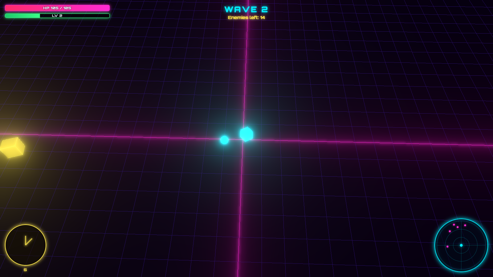
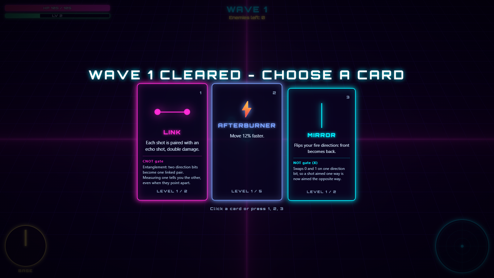
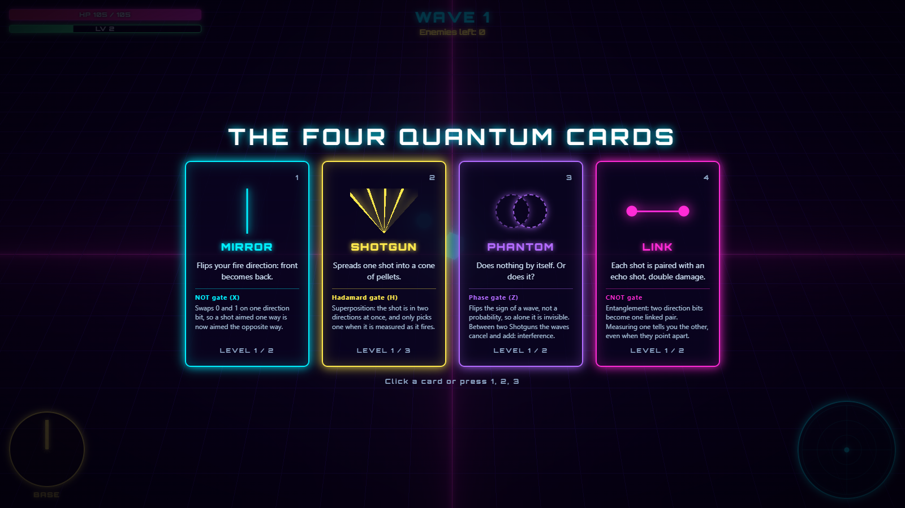
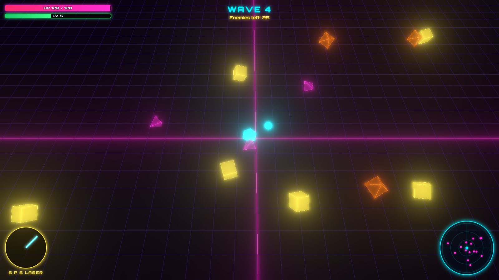
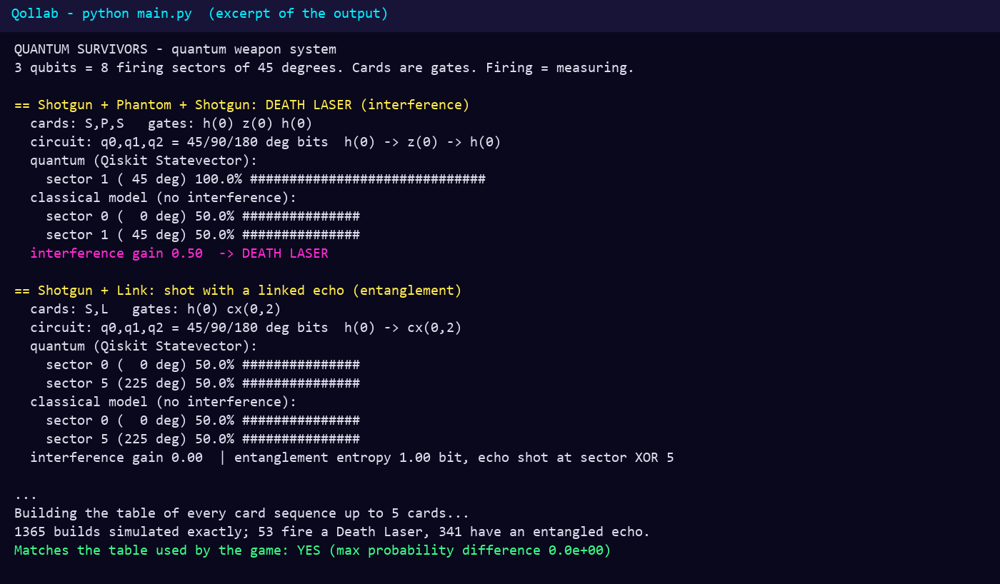

**This effort is supported by Qollab & IonQ**

# Quantum Survivors: a Game Where Quantum Gates Are Your Weapons

**Theme:** Quantum Playground · **Status:** Hackathon submission (Qollab) · **[Play it in the browser](https://agustindiazcano.github.io/quantum-survivors/)** · Project page on Qollab: _TODO link_

**Demo video:** _TODO public link (2 to 3 minutes)_

## 1. What is it?

Quantum Survivors is a neon, Vampire Survivors-style 3D web game. Your ship fires automatically at hordes of simple geometric enemies, and after every wave you pick a power card. The enemies are ordinary. **The weapons are quantum.** You never see an equation: you see a cone of shots, a shot that turns around, a linked echo, or a Death Laser.

Under the hood, your weapon is a 3-qubit register that decides the direction of each shot (8 sectors of 45 degrees). Firing is a measurement. Every card is a real quantum gate, added in the order you pick it:

| Card | Gate | Quantum idea | What you see |
|---|---|---|---|
| Mirror | NOT (X) | Flips a direction bit | Shots turn around |
| Shotgun | Hadamard (H) | Superposition | A spread of shots |
| Phantom | Phase (Z) | Invisible alone, but changes interference | Nothing alone; changes later combos |
| Link | CNOT | Entanglement | A shot plus a linked echo shot |

**The order of the cards matters, like in a real circuit.** Shotgun, Phantom, Shotgun does not give a wider cone: the two spreads cancel by interference and fuse into one Death Laser (all the shots in one direction). A classical random weapon cannot do that, because it only mixes probabilities and never cancels them. The code computes both models and reports the difference.

| Build | Quantum (Qiskit Statevector) | Classical model (no interference) |
|---|---|---|
| Shotgun | 50% sector 0, 50% sector 1 | same |
| Shotgun, Phantom, Shotgun | **100% sector 1 (Death Laser)** | 50% / 50% |
| Shotgun, Link | 50% sector 0, 50% sector 5, entangled (1.00 bit of entropy) | same distribution, but no entanglement |

## Screenshots



*Gameplay. The ship fires automatically at waves of tetrahedra, cubes and octahedra. The minimap (with edge dots for off-screen enemies) and the XP bar are in the HUD. The panel at the bottom left is the **weapon fan**: the probability of each of the 8 firing directions for the current build, read from the Qiskit table.*



*Card screen. After every wave you choose one of three cards. Each card is a quantum gate, but the player only sees a friendly name and a visible effect. The order in which you pick them changes the result.*



*The four quantum cards (open the game with `?preview` to see them with their notes): **Mirror** (NOT, flips a direction bit), **Shotgun** (Hadamard, superposition), **Phantom** (Phase, invisible alone but changes interference) and **Link** (CNOT, entanglement).*



*The Death Laser. Shotgun, Phantom, Shotgun: the two spreads cancel by interference and all the shots go in one direction. A classical random weapon would still split 50/50.*



*`qollab/main.py` running on Qollab: the Qiskit vs classical comparison for each example build, the 1,365-build table and the final check against the table the game uses.*

## 2. Why does it matter, and who is it for?

Superposition, interference and entanglement are hard to feel from a textbook. This game is for curious players, students and teachers who want to build intuition by playing: the combos that work are the ones that need interference, and the player discovers them by experimenting, not by reading about them. It is also a small, readable example of how to drive game logic from real Qiskit calculations instead of ad-hoc percentages.

## 3. How does the quantum part work?

- The rules live in `qollab/qgame/weapon.py`: each card appends a gate to a 3-qubit Qiskit circuit, the exact `Statevector` gives the shot-direction probabilities, and a classical model without interference is computed next to it. The interference gain, the laser rule and the entanglement entropy come from that comparison.
- `qollab/qgame/table.py` simulates **every card sequence up to 5 cards: 1,365 builds, 53 of them fire a Death Laser and 341 have an entangled echo.** No randomness, no network: exact statevectors.
- The result is exported to `qollab/data/weapon_table.json`. **The game reads that precomputed table; it does not run Qiskit live in the browser and it does not re-implement the gate rules.** Each shot samples a direction from the stored probabilities.
- `qollab/main.py` is the entry point on Qollab: it prints the example builds (Qiskit vs classical), rebuilds the whole table and checks that it matches the table shipped with the game.

Design notes and open questions: [docs/WEAPON_SYSTEM.md](docs/WEAPON_SYSTEM.md). Hackathon rules: [docs/RULES.md](docs/RULES.md).

**What we contribute:** a mapping from quantum gates to game mechanics where interference and entanglement have a visible effect, a table of all 1,365 builds computed with Qiskit, and a playable 3D game that uses it.

**Limits, stated plainly:** this is a playable proof of concept. Game balance and visuals have not been tuned or play-tested at length. We did not run on quantum hardware, only the Qiskit exact simulator on Qollab. The accessibility pass is not done yet.

## 4. How do I run it?

**Play:** open https://agustindiazcano.github.io/quantum-survivors/ (move with WASD or the arrow keys; the weapon fires on its own). Add `?preview` to the URL to see the quantum cards and their notes.

**On Qollab:** open the project page, upload the contents of `qollab/` (`main.py`, `qgame/`, `data/weapon_table.json`, `requirements.txt`, `LICENSE`) and run `main.py` with the built-in simulator. It takes about 10 seconds and prints the example builds, builds the table and ends with `Matches the table used by the game: YES`.

**Locally:**
```
npm install
npm run dev            # the game

pip install -r qollab/requirements.txt pytest
python qollab/main.py            # demo builds + check against the game's table
python qollab/main.py --export   # regenerate qollab/data/weapon_table.json
python -m pytest
```

## Stack

Plain JavaScript, HTML and CSS, 3D with three.js (WebGL, bloom glow). Vite for development, built as a single HTML file. Quantum calculations: Python with Qiskit and NumPy in `qollab/`.

## Hackathon node and team

Competing at the **UNICEN** node (Universidad Nacional del Centro de la Provincia de Buenos Aires, Argentina): https://exa.unicen.edu.ar/ · Track: *Professional*

**Team Salta**
- Agustin Diaz-Cano, MS Candidate, Information Systems Engineering (UTN)
- Baltazar Salerno, Frontend Developer

## Disclosure

- AI tools used: Claude (chat: planning, review) and Claude Code (coding agent, code and documentation assistance), Gemini Antigravity (planning, coding agent and brainstorming, web search), Grok (brainstorming, web search).
- Libraries: Vite, three.js, @fontsource/orbitron (font); Qiskit and NumPy for the quantum side.

## License

MIT. See [LICENSE](LICENSE) (also copied in `qollab/LICENSE`). Copyright (c) 2026 Agustin Diaz Cano and Baltazar Salerno.
